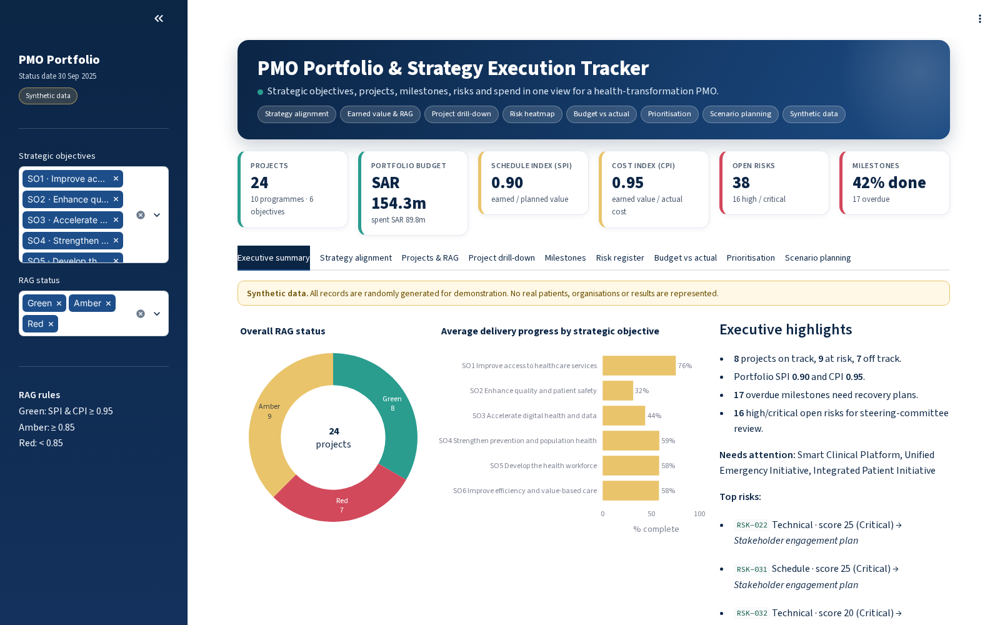
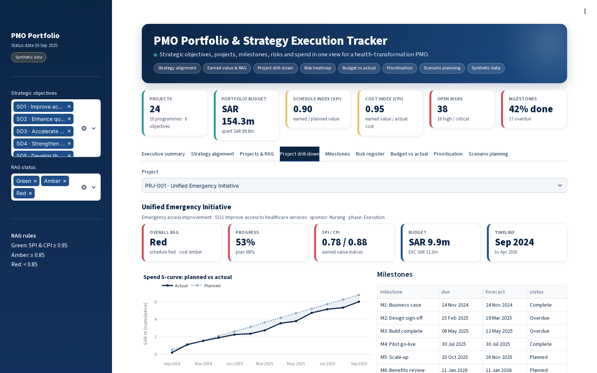
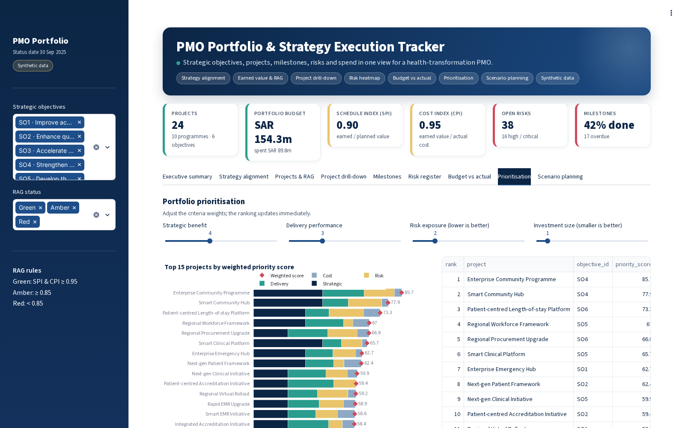
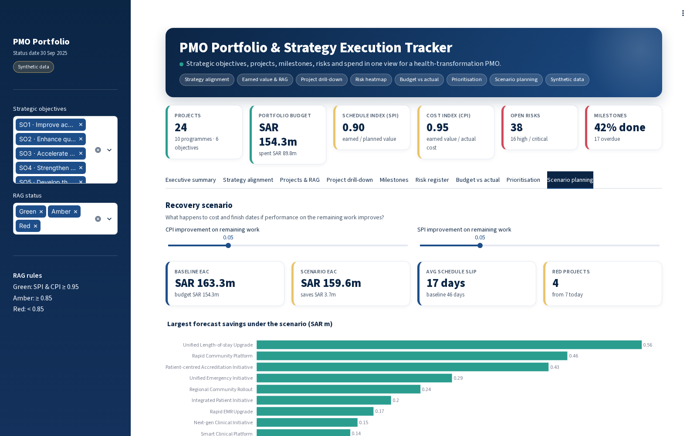
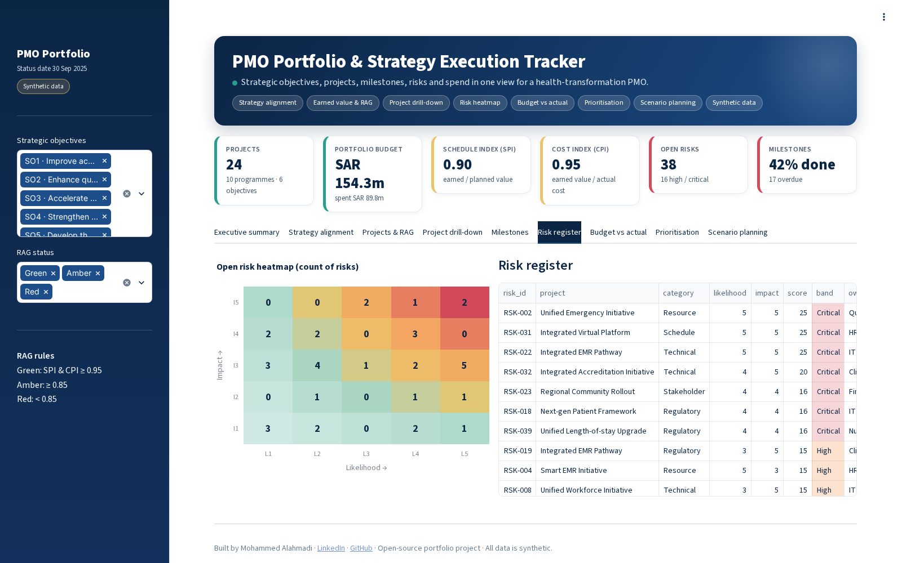
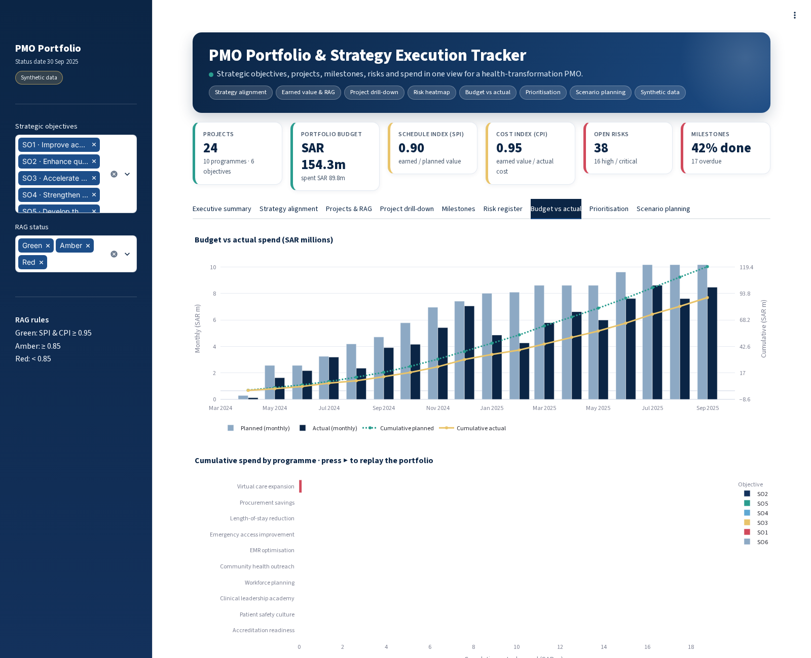
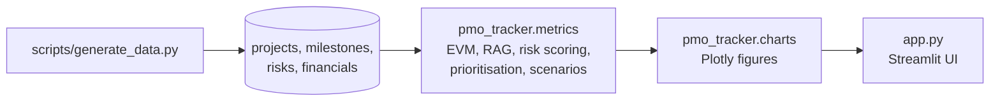

<div align="center">

# PMO Portfolio & Strategy Execution Tracker

**Portfolio view for a healthcare PMO: strategy alignment, earned-value RAG, project drill-down, risks, spend, prioritisation and recovery scenarios.**

    [](https://github.com/MOHAMMEDYOUSEFALAHMADI/pmo-portfolio-tracker/actions/workflows/tests.yml)  

</div>

> **Synthetic data only.** Every record in this repository is generated by a script with a fixed random seed.
> No real patients, staff, organisations or payers are represented, and the figures are not real-world results.

## Why this project

A transformation PMO has to answer the same questions every month for its steering committee: are the
projects delivering the strategy, which ones are off track and why, where is the money going, and what
needs a decision. Status reports based on self-declared RAG colours rarely answer these consistently.

This tracker links every project to a strategic objective and derives its status from earned value
(SPI and CPI) instead of opinion. It adds the views a PMO lead uses to prepare a steering committee pack:
an executive summary, project-level drill-down with an S-curve, milestones, a risk heatmap, budget vs actual,
a weighted prioritisation model and a recovery scenario that re-forecasts cost and finish dates.

## Features

- **Executive summary**: RAG distribution, objective roll-up, highlights, top risks and a decisions-requested table
- **Strategy alignment** sunburst from objective to programme to project
- **Earned-value RAG**: SPI and CPI per project, schedule / cost / overall RAG and estimate at completion
- **Project drill-down**: KPIs, spend S-curve (planned vs actual), milestones and risks for any project
- **Milestone timeline** with overdue tracking
- **Risk register** with a 5 × 5 likelihood-impact heatmap
- **Budget vs actual** by month and an animated replay of cumulative spend by programme
- **Prioritisation**: weighted scoring on strategic benefit, delivery performance, risk exposure and investment size; the ranking updates as the weights change
- **Recovery scenario**: re-forecasts portfolio EAC and schedule slip if CPI and SPI improve on the remaining work

## Screenshots

**Executive summary**



**Project drill-down with S-curve, milestones and risks**



**Weighted portfolio prioritisation**



**Recovery scenario: EAC and schedule slip**



**Risk heatmap and register**



**Budget vs actual and animated spend by programme**



## KPIs and methods

| Measure | Definition |
|---|---|
| SPI | earned value ÷ planned value |
| CPI | earned value ÷ actual cost |
| RAG | Green ≥ 0.95, Amber ≥ 0.85, Red < 0.85 (worst of SPI and CPI) |
| EAC | actual cost + (budget − earned value) ÷ future CPI |
| Schedule slip | planned duration ÷ future SPI − planned duration |
| Risk score | likelihood (1–5) × impact (1–5); Low ≤ 4, Medium ≤ 9, High ≤ 15, Critical ≥ 16 |
| Priority score | weighted average of four 0–100 criteria: strategic benefit, delivery (min of SPI, CPI), risk exposure, investment size |

## Architecture



```text
pmo-portfolio-tracker/
├── app.py                    # Streamlit app
├── pmo_tracker/
│   ├── charts.py             # Plotly figures
│   ├── config.py             # strategic objectives, programmes, RAG and risk rules
│   ├── data.py               # synthetic portfolio generator
│   ├── metrics.py            # earned value, RAG, risks, prioritisation, scenarios
│   └── ui.py                 # theme, KPI cards and layout helpers
├── scripts/                  # data generation
├── data/                     # synthetic CSV files
├── tests/                    # pytest suite
├── docs/screenshots/
├── .streamlit/config.toml    # theme
├── .github/workflows/        # CI: pytest on every push
└── requirements.txt
```

## Getting started

```bash
git clone https://github.com/MOHAMMEDYOUSEFALAHMADI/pmo-portfolio-tracker.git
cd pmo-portfolio-tracker
python -m venv .venv
source .venv/bin/activate        # Windows: .venv\Scripts\activate
pip install -r requirements.txt

streamlit run app.py             # http://localhost:8501
```

To regenerate the synthetic data:

```bash
python scripts/generate_data.py --projects 24 --seed 15
```

## Tests

```bash
pytest
```

The suite checks the data generator, every KPI calculation, the scenario logic and that each chart builds.

## Tech stack

Python · Streamlit · pandas · NumPy · Plotly · pytest

## Data statement

The data is produced by `scripts/generate_data.py` from random distributions with fixed seeds, so every run
is reproducible. Names of units, stations, payers, projects and objectives are generic placeholders. The app
has not been deployed in any organisation, and nothing here should be read as a measured outcome.

## Roadmap

- [ ] Benefits realisation tracking against the business case
- [ ] Resource capacity view across projects
- [ ] Import from MS Project / Excel templates
- [ ] Auto-generated steering committee slide pack

## Author

**Mohammed Alahmadi** · healthcare operations, quality, EMS and PMO
[LinkedIn](https://www.linkedin.com/in/mohyou) · [GitHub](https://github.com/MOHAMMEDYOUSEFALAHMADI)

## License

[MIT](LICENSE)
